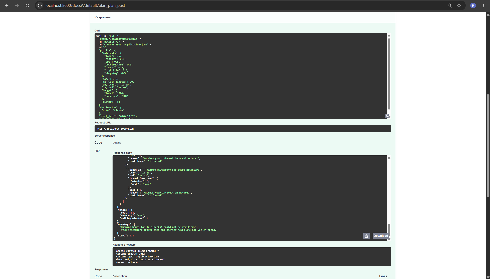
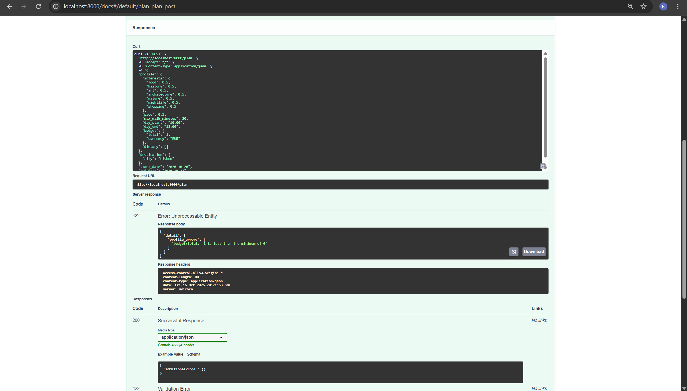
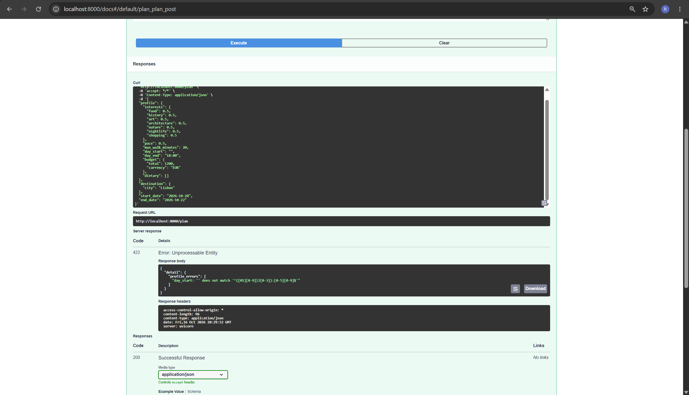
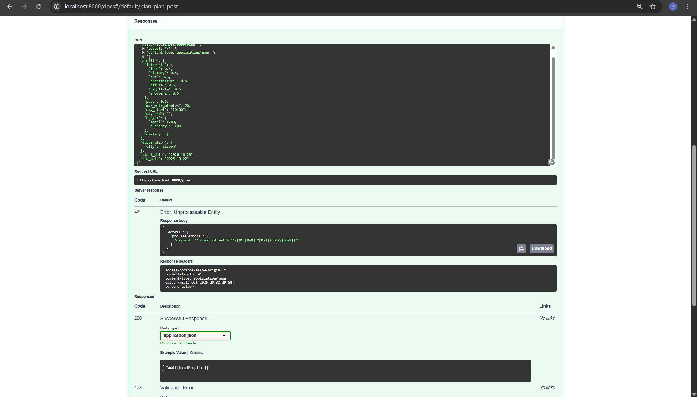
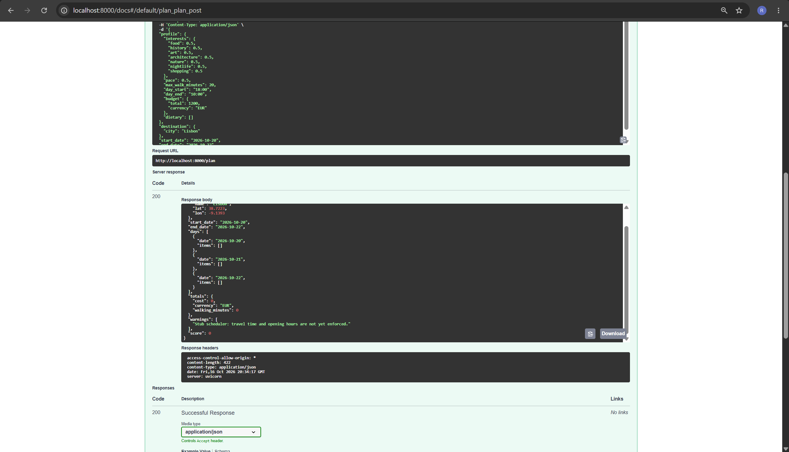
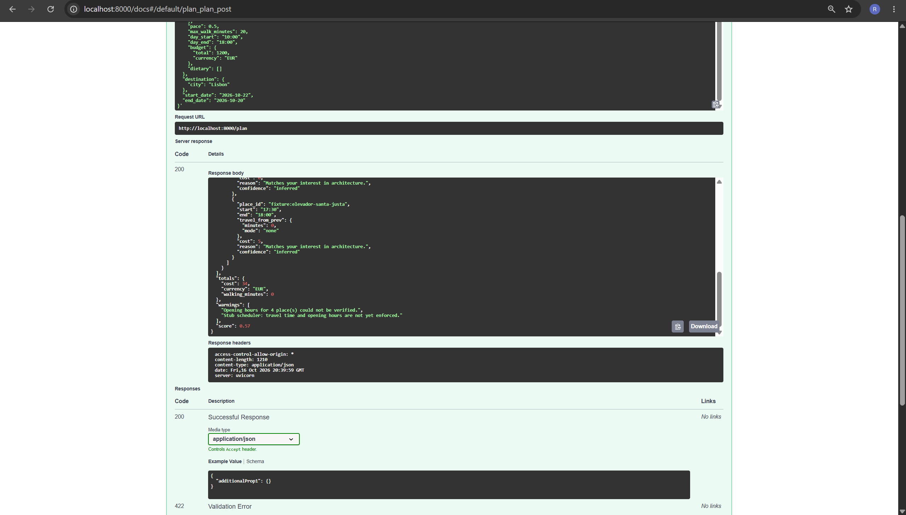

# Sprint 1 backend testing

Tested by: Bala Ravi Raja Polisetty
Date: October 16, 2026
Tested branch: feature/frontend-form-validation
Backend: Basic backend included in that downloaded branch
Tested on: Windows laptop using Chrome

I tested the backend directly through http://localhost:8000/docs.
I used POST /plan and changed one input at a time.
These checks did not use the frontend form.

## Starting request

This was the valid request I started with.
For each test below, I changed only the fields mentioned
and restored the previous field before continuing.

{
  "profile": {
    "interests": {
      "food": 0.5,
      "history": 0.5,
      "art": 0.5,
      "architecture": 0.5,
      "nature": 0.5,
      "nightlife": 0.5,
      "shopping": 0.5
    },
    "pace": 0.5,
    "max_walk_minutes": 20,
    "day_start": "10:00",
    "day_end": "18:00",
    "budget": {
      "total": 1200,
      "currency": "EUR"
    },
    "dietary": []
  },
  "destination": {
    "city": "Lisbon"
  },
  "start_date": "2026-10-20",
  "end_date": "2026-10-22"
}

## 1. Valid request

Response code: 200

The backend returned a Lisbon itinerary for October 20–22.
It contained 12 stops and a total cost of EUR 84.
This matched the result from the earlier integration test.

## 2. Negative budget

Changed budget total to -1.

Response code: 422

The backend rejected it with:
"budget/total: -1 is less than the minimum of 0"

This check worked as expected.

## 3. Walking value above the limit

Restored budget to 1200 and changed max_walk_minutes to 241.

Response code: 422

The backend rejected it with:
"max_walk_minutes: 241 is greater than the maximum of 240"

This check worked as expected.

## 4. Blank day start

Restored max_walk_minutes to 20 and set day_start to "".
Day end stayed at "18:00".

Response code: 422

The backend rejected the empty start time.
The response contained profile_errors and the required
time-format pattern.

This confirms that the backend catches the blank value.
The frontend should show a simple missing-time message
instead of displaying this technical response to the user.

## 5. Blank day end

Restored day_start to "10:00" and set day_end to "".

Response code: 422

The backend rejected the empty end time.
The response contained profile_errors and the required
time-format pattern.

This check worked as expected.

## 6. Reversed daily times

Set day_start to "18:00" and day_end to "10:00".

Response code: 200

The backend accepted the request and returned three days
with no stops, a total cost of EUR 0, and a score of 0.

The updated frontend blocks these times, but the backend
accepted them. Both should follow the same rule.
If overnight plans are supported later, that needs a clear rule.

## 7. Equal daily times

Set both day_start and day_end to "10:00".

Response code: 200

The backend accepted the request and returned three empty
days, a total cost of EUR 0, and a score of 0.

The updated frontend blocks equal times.
The backend should also reject them with a clear message.

## 8. All interests at zero

Restored daily times to "10:00"–"18:00".
Set all seven interests to 0.0.

Response code: 200

The backend accepted the request and returned three empty
days, a total cost of EUR 0, and a score of 0.

The updated frontend requires at least one interest above
zero. The backend should follow that same rule, unless
the team decides to support a default plan instead.

## 9. End date before start date

Restored all seven interests to 0.5.
Set start_date to "2026-10-22"
and end_date to "2026-10-20".

Response code: 200

The backend accepted the reversed dates.
It returned one day, October 22, with four stops
and a total cost of EUR 34.

It should reject an end date earlier than the start date,
as the frontend already does.

## Main findings

The valid request worked. The backend also rejected
negative budget, walking above 240, and blank daily times.

It accepted reversed daily times, equal daily times,
all-zero interests, and reversed travel dates.
These checks need to match the rules used by the frontend.

## Testing limits

These were manual checks of the basic POST /plan endpoint.
They do not cover every input or confirm that the full
backend is finished.

The returned itinerary warns that travel time and opening
hours are not yet enforced. These tests did not verify
real-world route feasibility or live data.

## AI assistance

I used ChatGPT for basic wording and organizing this report.
I did the testing and took the screenshots myself.