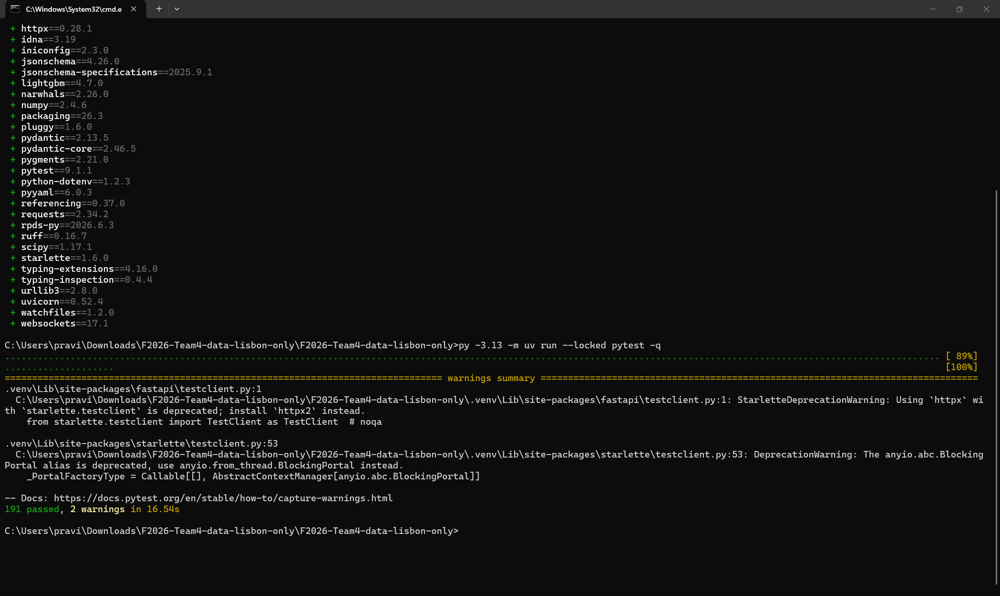
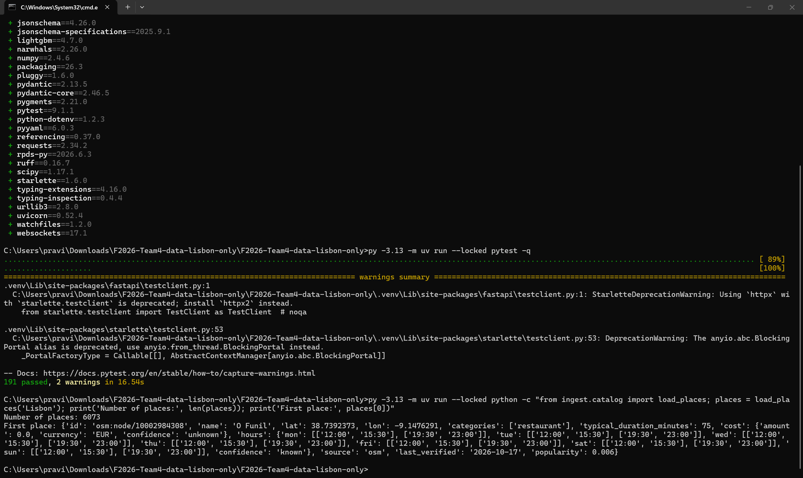
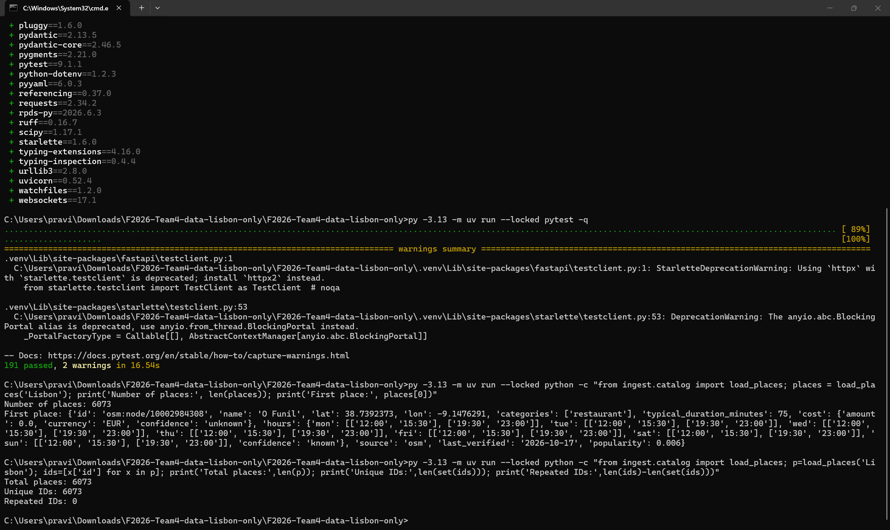
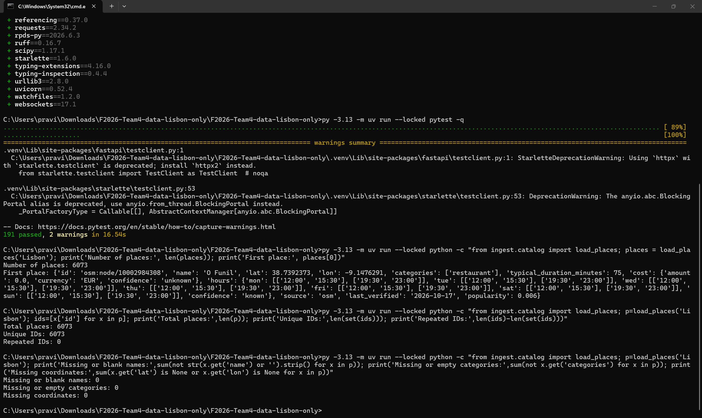
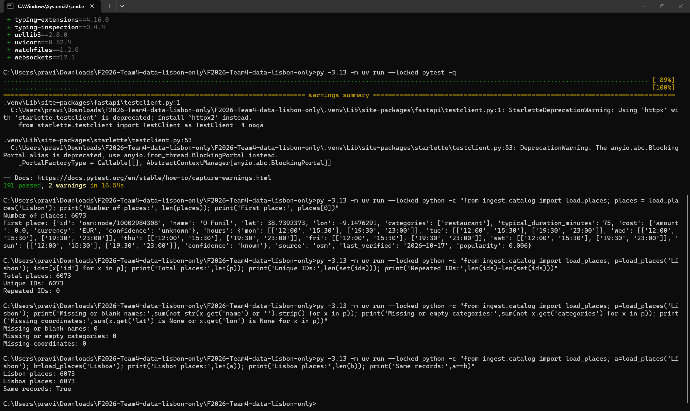
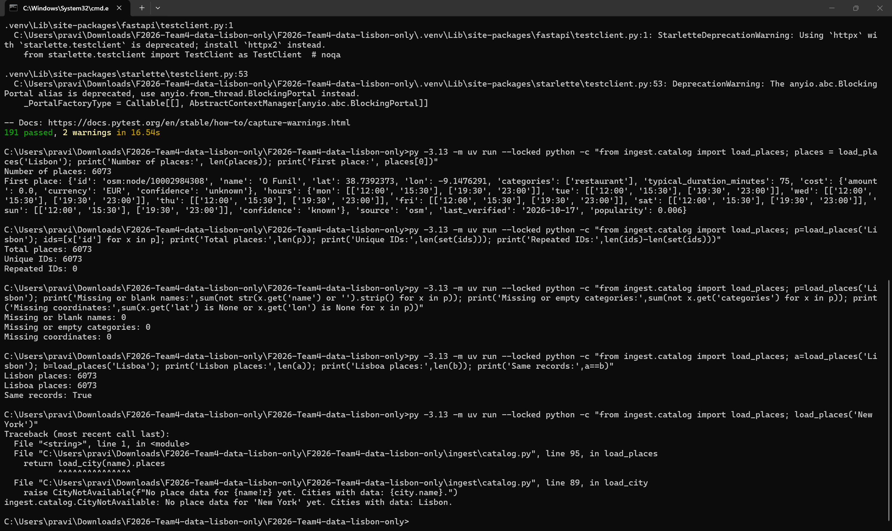
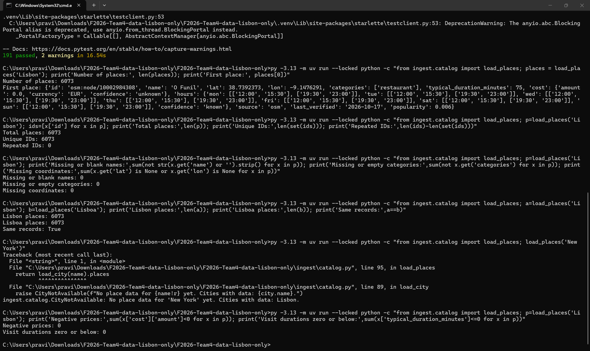
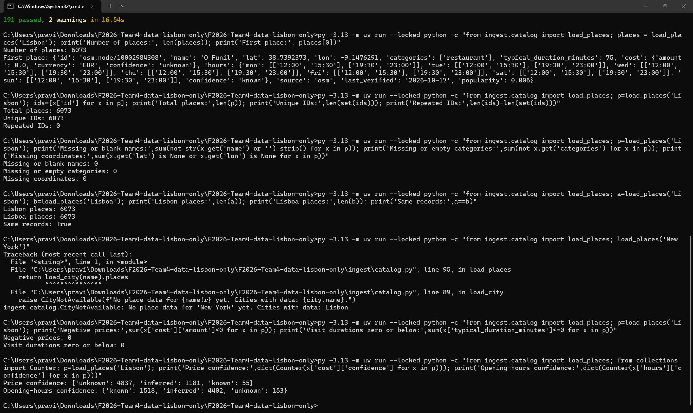
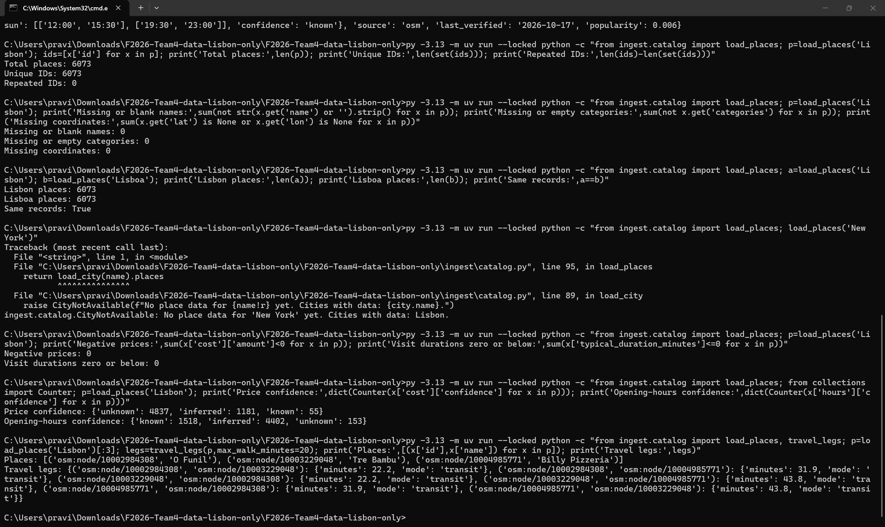
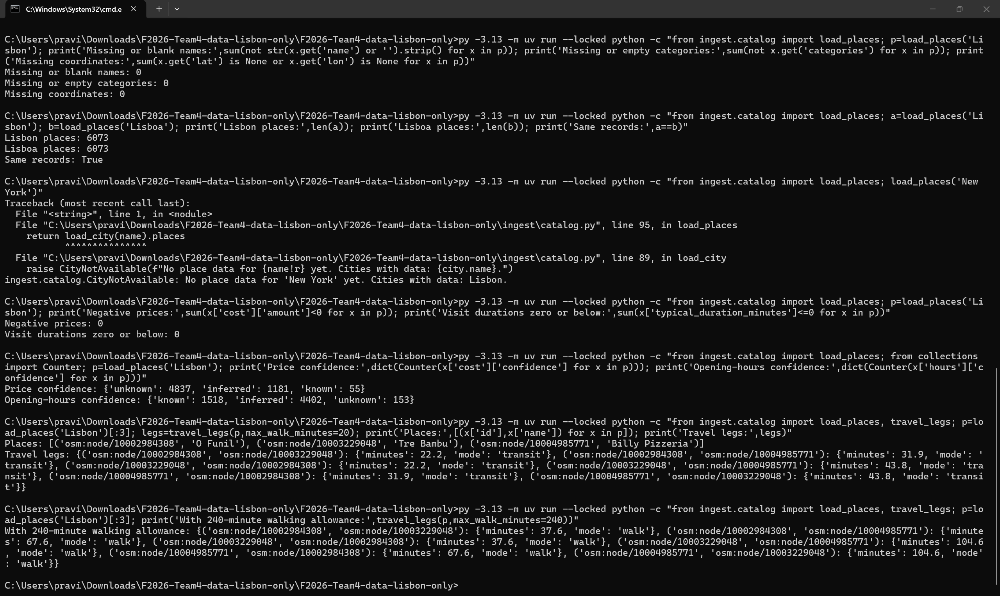

# Sprint 1 data testing

Tested by: Bala Ravi Raja Polisetty
Date: October 18, 2026
Branch tested: data/lisbon-only
Tested on: Windows laptop using Command Prompt
Python environment: 3.11.17

I downloaded the data/lisbon-only branch, installed its
dependencies, and ran the existing Python tests. I also ran
separate checks on the Lisbon data and travel estimates.

These results are only for the downloaded branch.

## Existing automated tests

Command:
`py -3.13 -m uv run --locked pytest -q`

Result: 191 passed, 2 warnings in 16.54 seconds.

The warnings were about deprecated testing-library usage.
No tests failed. These tests were already in the branch;
I did not write them.

## Data checks

### Lisbon data loads

The data loader returned 6,073 places for Lisbon.
I also checked the first record printed in the terminal.

Result: Passed.

### Place IDs are unique

Total records: 6,073
Unique IDs: 6,073
Repeated IDs: 0

Result: Passed.

This checks repeated IDs only. The same real place could
still appear under different IDs; I did not check that.

### Basic fields are present

Missing or blank names: 0
Missing or empty categories: 0
Missing coordinates: 0

Result: Passed.

This checks that these fields are present. It does not
confirm that every name, category, or location is correct.

### Lisboa returns the same data as Lisbon

Both names returned 6,073 places.
Comparing the full returned lists gave True.

Result: Passed.

### Unsupported city is rejected

I requested New York directly through the data loader.

It raised CityNotAvailable and said:
"No place data for 'New York'. Cities with data: Lisbon."

Result: Passed for the data loader.

I did not check the API response for this case.

### Prices and visit durations

Negative prices: 0
Visit durations of zero or below: 0

Result: Passed for these checks.

This does not confirm that the prices or durations match
real-world values.

## Data limitations noticed

I counted the confidence labels stored in the data:

| Label | Prices | Opening hours |
|---|---:|---:|
| Known | 55 | 1,518 |
| Inferred | 1,181 | 4,402 |
| Unknown | 4,837 | 153 |

Most prices are marked unknown, and most opening hours
are marked inferred.

Inferred information uses estimates or defaults.
Unknown information is unavailable.

A price of 0 marked unknown should not be treated as
confirmation that a place is free. Unknown opening hours
should not be treated as confirmation that a place is closed.

I checked the stored labels, not the accuracy of the
information against official sources.

## Travel estimate checks

### With a 20-minute walking allowance

I used the first three places returned by the loader:
O Funil, Tre Bambu, and Billy Pizzeria.

The code returned six travel legs, covering both directions
between each pair.

All six used transit. The estimates were 22.2, 31.9,
and 43.8 minutes, with matching estimates in reverse.

Result: The calculation completed and returned positive
travel estimates for these pairs.

### With a 240-minute walking allowance

I used the same three places and increased the walking
allowance to 240 minutes.

All six travel legs changed to walk.
The walking estimates were 37.6, 67.6, and 104.6 minutes,
with matching estimates in reverse.

All were within the 240-minute allowance.

Result: Passed for these sample pairs.

## Scope of this testing

These checks covered data loading, basic field presence,
unique IDs, one city alias, unsupported-city handling,
price and duration checks, confidence labels, and travel
estimates for three places.

I did not verify every place against official sources,
check actual journey times, rebuild the data collection
pipeline, or test this branch through the full frontend
and backend flow.

Passing these checks does not mean the whole application
or all real-world data has been verified.

## AI usage

I used ChatGPT to help writing this report.
I ran the commands and took the screenshots myself.