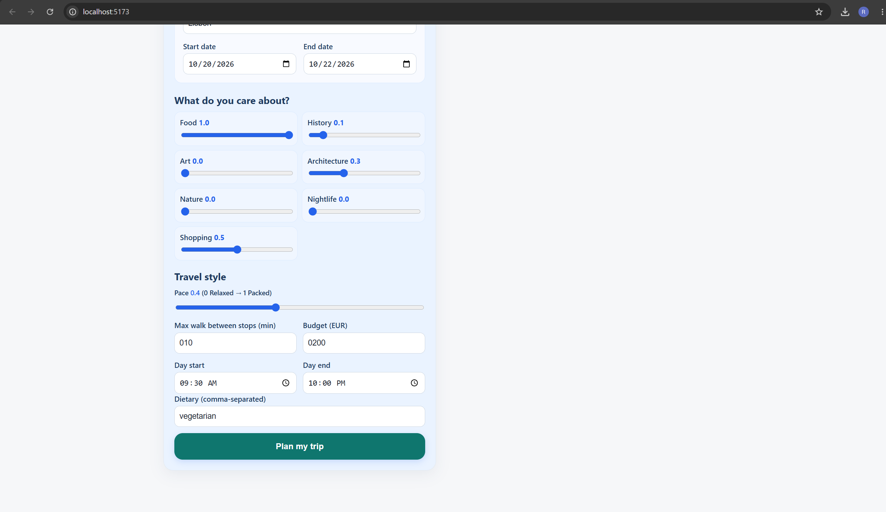
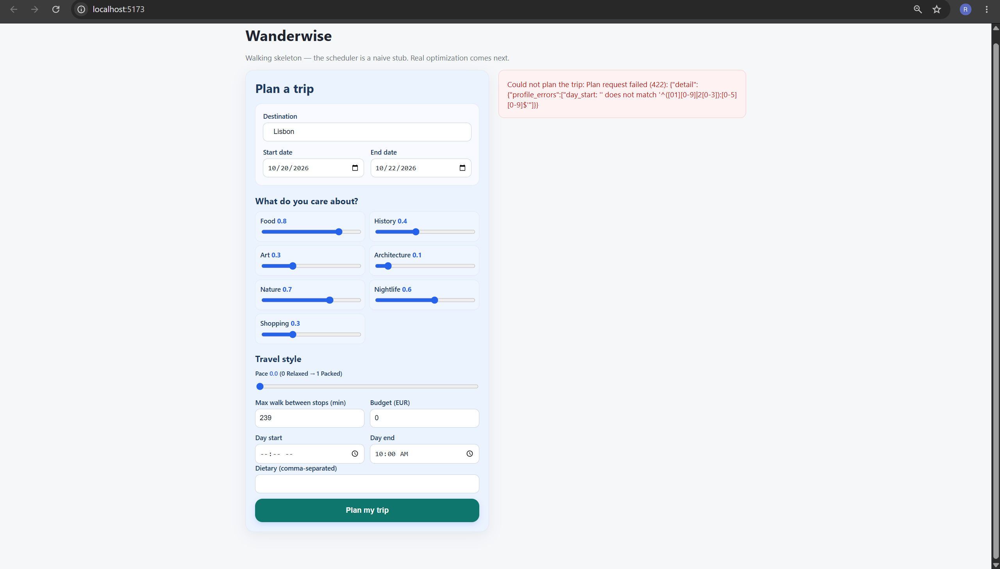
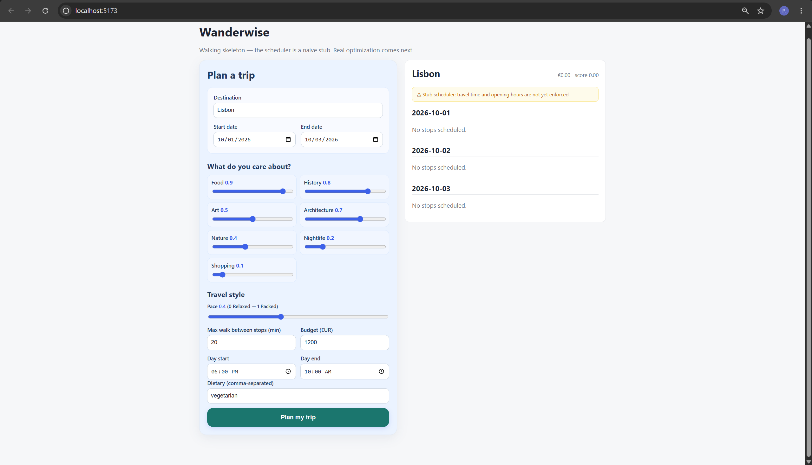
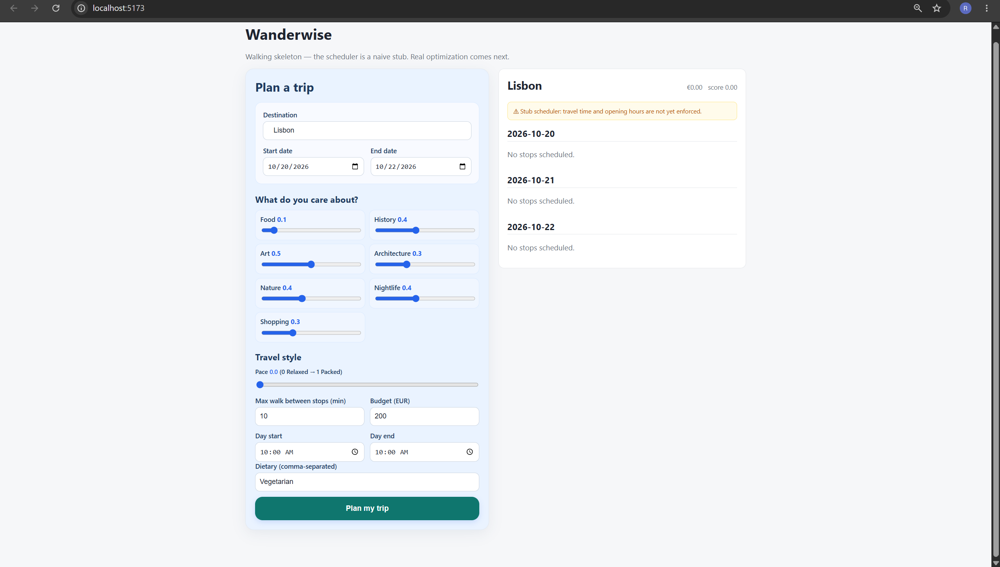
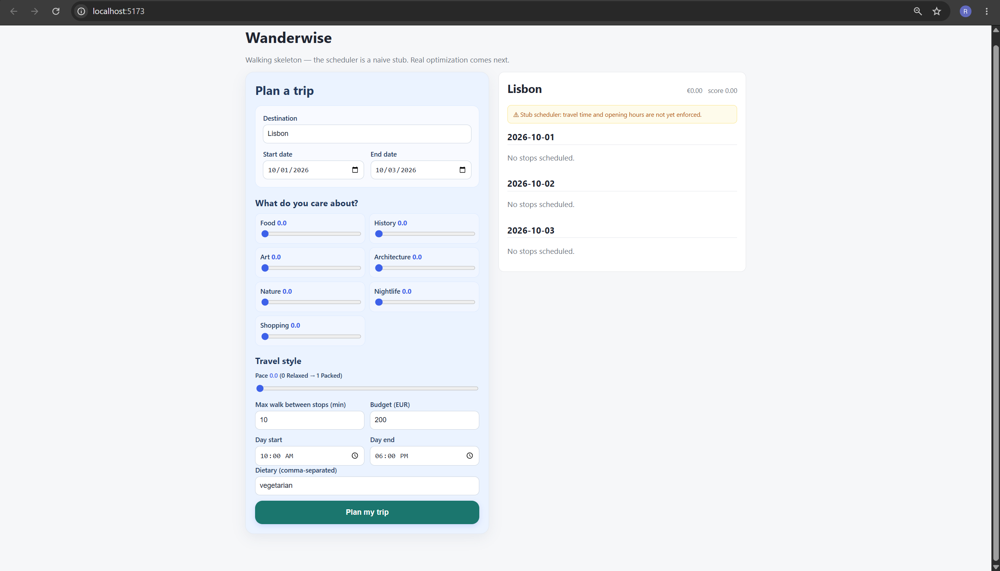
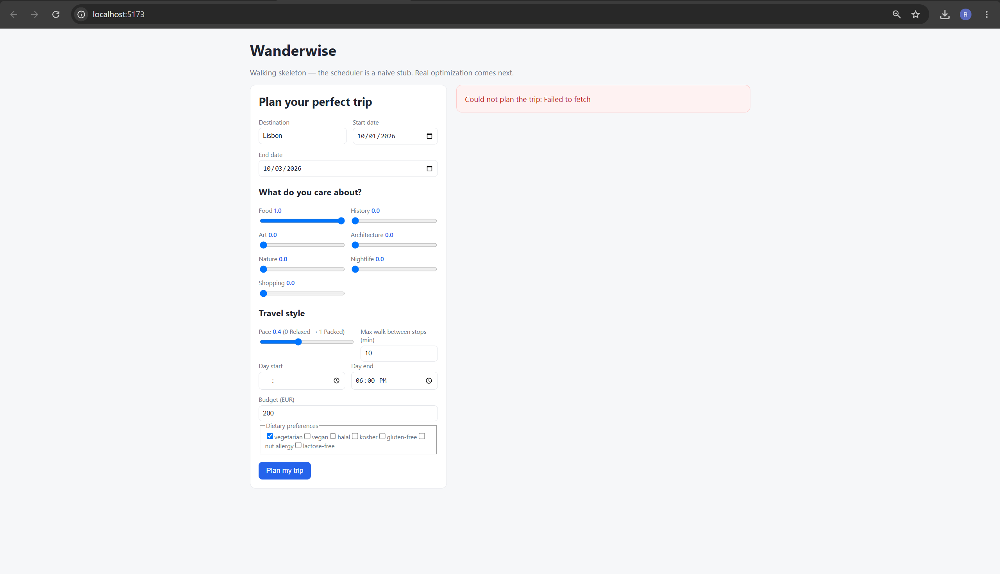
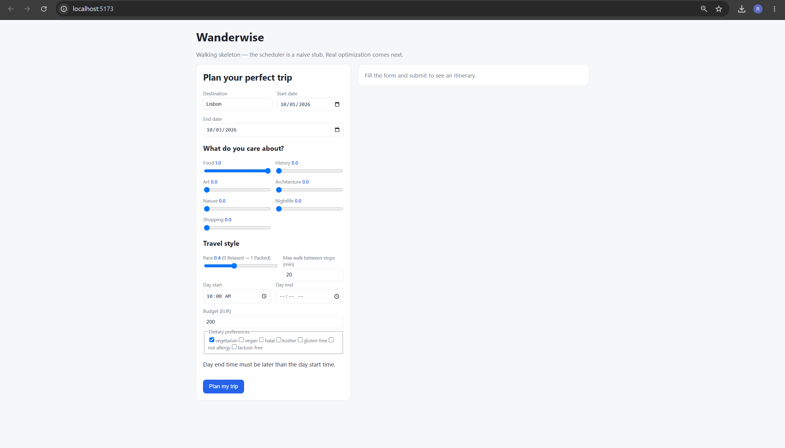

# Sprint 1 frontend testing

Tested by: Bala Ravi Raja Polisetty
Date: October 14, 2026
Branch: feature/frontend-ui-improvements
Tested on: Windows laptop using Chrome

I tested the frontend form on my laptop. I also ran the basic
backend to check blank daily times, equal/reversed daily times,
and all interests set to zero.

## What worked

- The page opened properly.
- All seven interest sliders changed from 0.0 to 1.0.
- The pace slider worked too.
- I could change the destination, dates, and daily times.
- The dietary field accepted text and could be left empty.
- An empty destination showed "Please enter a destination."
- Entering only spaces showed the same warning.
- Missing either travel date showed
  "Please select both travel dates."
- An end date before the start date showed a warning.
- Using the same travel date for both fields was allowed.
  I haven't checked the resulting itinerary yet.
- Negative budget and walking values were blocked.
- A walking value above 240 was blocked.
- When the backend was off, an error appeared.
  The button became usable again afterward.
- The form still fit when I made the window narrower.
  I needed to scroll down, but not sideways.
- I could reach the button using Tab.

## Problems I found

### Budget and walking fields keep adding a zero

When I deleted the budget value, 0 appeared automatically.
Then typing 200 made it show 0200.
It stayed that way even after clicking outside.

The walking field did the same thing.
Typing 10 after clearing it showed 010.

Selecting everything with Ctrl+A and typing the new number
worked around it.

I haven't checked what number gets sent to the backend yet.

### Empty daily times show a technical error

I cleared Day start and clicked Plan my trip.
It showed a long 422 error with profile_errors.

The same thing happened when I cleared Day end.

A simple message like "Please select a start time"
or "Please select an end time" would be easier to understand.

## Things we need to clarify

I checked these again with the basic backend running:

- Day start at 6 PM and day end at 10 AM:
  No time warning appeared. It returned an itinerary
  with no stops scheduled.

- Both daily times set to 10 AM:
  No time warning appeared. It returned an itinerary
  with no stops scheduled.

  

- All interests set to 0.0, with daily times from 10 AM to 6 PM:
  No preference warning appeared. It returned an itinerary
  with no stops scheduled.

  

Should equal/reversed daily times be blocked?
Are we supporting overnight activities?

For zero interests, should we ask the user to select at least
one interest, or provide a default plan?

## Checks I ran

- npm.cmd test: all 3 existing tests passed.
- npm.cmd run typecheck: no errors appeared.
- npm.cmd run build: completed successfully.

The existing tests only check formatting helpers.
They don't test the full form or the frontend/backend flow.

These results are from the version tested on October 14.
Fixes haven't been retested yet, and a working itinerary
with scheduled stops hasn't been verified.

## Retest — October 16, 2026

Tested branch: feature/frontend-form-validation

I checked the updated form again.

### Fixes that worked

- Budget: clearing the field and typing 200 now shows 200.
- Max walk: clearing the field and typing 10 now shows 10.
- Day start at 6 PM and day end at 10 AM now shows:
  "Day end time must be later than the day start time."
- Setting both daily times to 10 AM shows the same warning.
- Setting all seven interests to zero now shows:
  "Please set at least one interest above zero so we know what you care about."

### Still needs attention

**Blank day start**

With Food at 1.0, day start empty, and day end at 6 PM,
clicking Plan my trip showed "Could not plan the trip: Failed to fetch."

There was no warning asking me to select a start time.
The frontend should catch the empty field before sending the request.
This test does not confirm how the backend handles it.

**Blank day end**

With Food at 1.0, day start at 10 AM, and day end empty,
the form showed "Day end time must be later than the day start time."

It showed a warning, but "Please select a day end time"
would explain the problem more clearly.

### Testing limits

This retest covered frontend form behavior.
I haven't verified a successful itinerary with scheduled stops
or rerun the automated checks on this updated version.