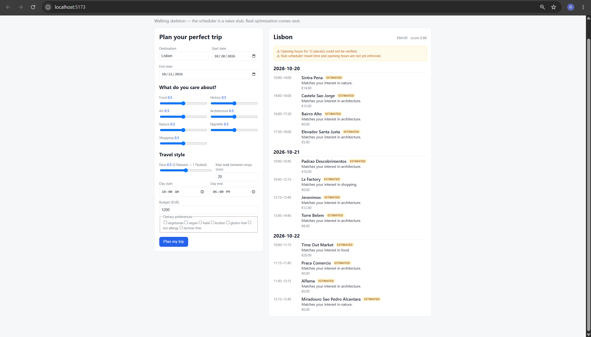
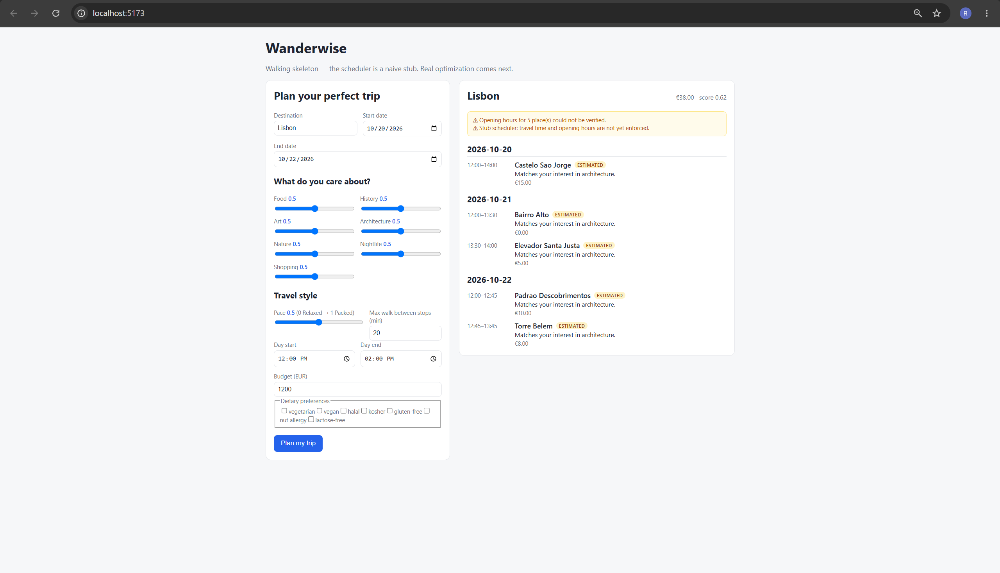
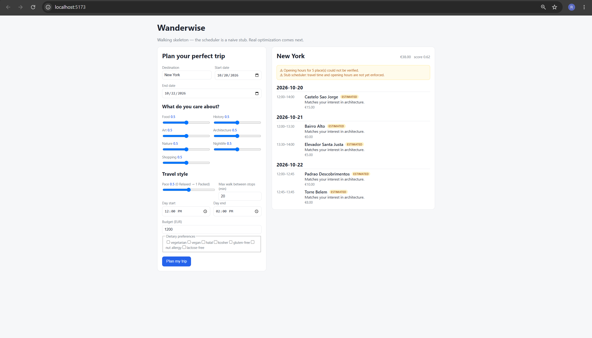
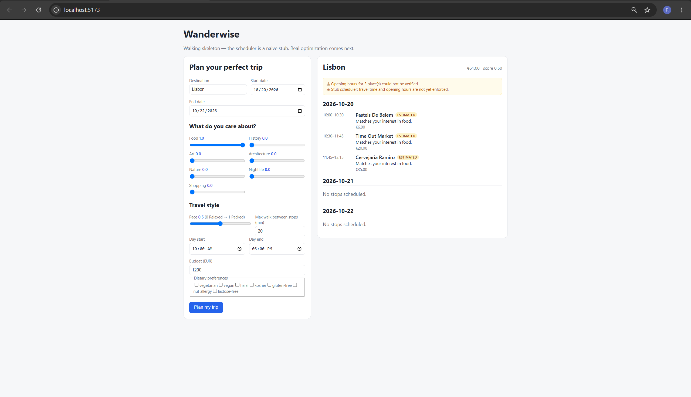
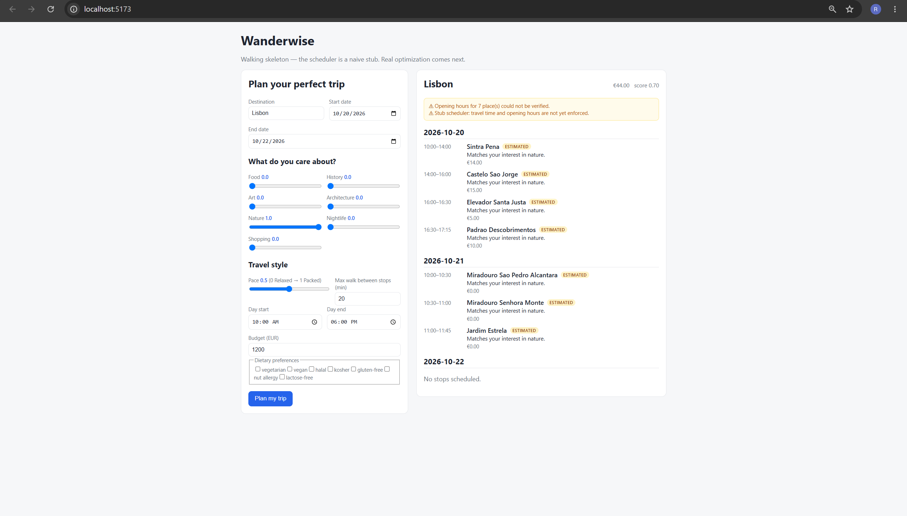
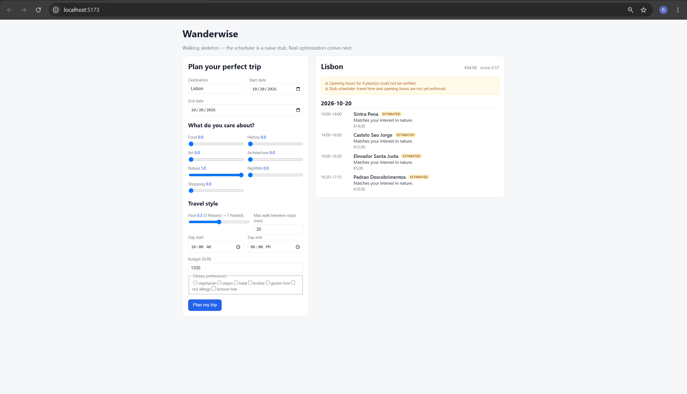
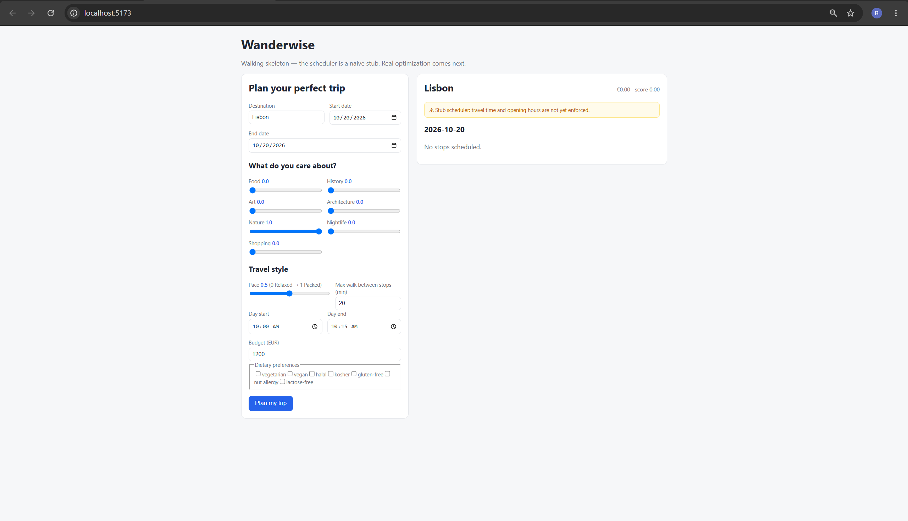

# Sprint 1 integration testing

Tested by: Bala Ravi Raja Polisetty
Date: October 16, 2026
Tested branch: feature/frontend-form-validation
Tested on: Windows laptop using Chrome
Backend: Basic backend included in the same downloaded branch

I ran the frontend and basic backend together on my laptop.
I entered trip details in the form and checked the itinerary
shown after clicking Plan my trip.

## Setup

- Frontend: http://localhost:5173/
- Backend: http://localhost:8000/
- The backend health page returned {"status":"ok"}.

## Starting inputs

I started with these details and changed the fields mentioned
in each test below:

- Destination: Lisbon
- Travel dates: October 20–22, 2026
- All seven interests: 0.5
- Pace: 0.5
- Max walk: 20 minutes
- Day start: 10 AM
- Day end: 6 PM
- Budget: EUR 1200
- Dietary preferences: all unchecked

## 1. Normal Lisbon trip

The form returned an itinerary for October 20–22.
It showed 12 stops with times and costs.
The displayed total was EUR 84.

The basic flow worked: I submitted the form, the backend
returned a result, and the frontend displayed it.

## 2. Shorter daily times

I changed the daily times to 12 PM–2 PM.

The result showed five stops across the three days.
All scheduled times stayed within 12 PM–2 PM,
and none overlapped within a day.
The displayed total was EUR 38.

## 3. Budget was not followed

Keeping the daily times at 12 PM–2 PM, I changed
the budget from EUR 1200 to EUR 10 and submitted again.

The itinerary still showed a total of EUR 38,
which was EUR 28 above the entered budget.
Pace was 0.5 for the saved result.

The budget limit was not enforced in this test.
The team should confirm when budget support is planned
and explain this limitation to users until then.

## 4. New York returned Lisbon places

I changed the budget back to EUR 1200 and the destination
to New York, keeping the daily times at 12 PM–2 PM.

The result heading changed to New York, but the stops
were still the Lisbon places from the previous test,
including Castelo Sao Jorge and Torre Belem.

For this starter version, the app should either return
places for the requested city or clearly say that only
Lisbon is supported.

## 5. Food-only interests

I changed the destination back to Lisbon and daily times
back to 10 AM–6 PM.

I set Food to 1.0 and all other interests to 0.0.

The result changed to three food stops:

- Pasteis de Belem
- Time Out Market
- Cervejaria Ramiro

The total was EUR 61.
All three stops were on October 20.
October 21 and 22 showed "No stops scheduled."

## 6. Nature-only interests

I set Food to 0.0 and Nature to 1.0.
All other interests stayed at 0.0.

The result changed to seven stops, with a total of EUR 44.
Four stops were on October 20 and three on October 21.
October 22 showed "No stops scheduled."

The food-only and nature-only tests returned different
plans, so changing interests affected the result.
I haven't fully checked whether every place's interest
category is suitable.

We should discuss whether to spread the available stops
across the travel dates or explain why some days are empty.

## 7. Single-day trip

Keeping the nature-only interests, I set both travel dates
to October 20, 2026.

The result showed only October 20, with four stops.
The stops ran from 10 AM to 5:15 PM.
The displayed total was EUR 44.

## 8. Only 15 minutes available

Keeping the single-day trip and nature-only interests,
I changed the daily times to 10 AM–10:15 AM.

The result showed "No stops scheduled," a total of EUR 0,
and a score of 0.00. No crash or technical error appeared.

A message like "No activities fit your selected time.
Try allowing more time" would help explain the empty result.

## Limits of these checks

These were manual checks of the form-to-backend flow
using the basic backend and sample data.

The app displayed a warning that travel time and opening
hours are not yet enforced. I haven't verified real-world
travel feasibility, opening hours, walking limits, dietary
filtering, or the accuracy of the displayed scores.

These results show that the basic integration works for
the tested inputs. They don't mean the full trip planner
is finished.

## AI assistance

I used ChatGPT for basic wording and organizing this report.
I did the testing and took the screenshots myself.