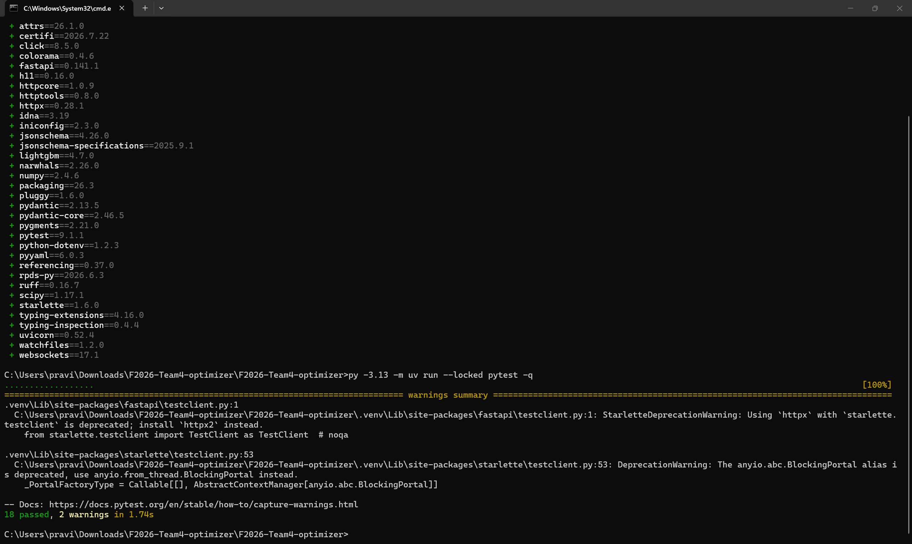
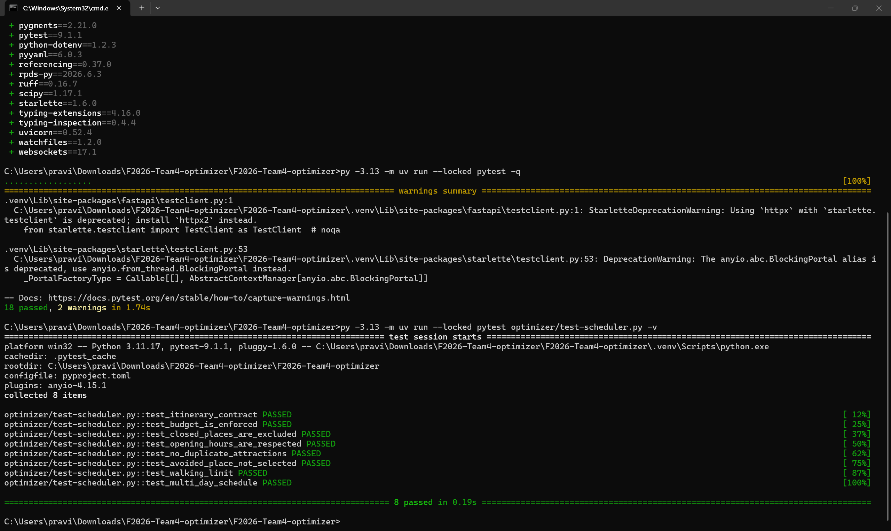
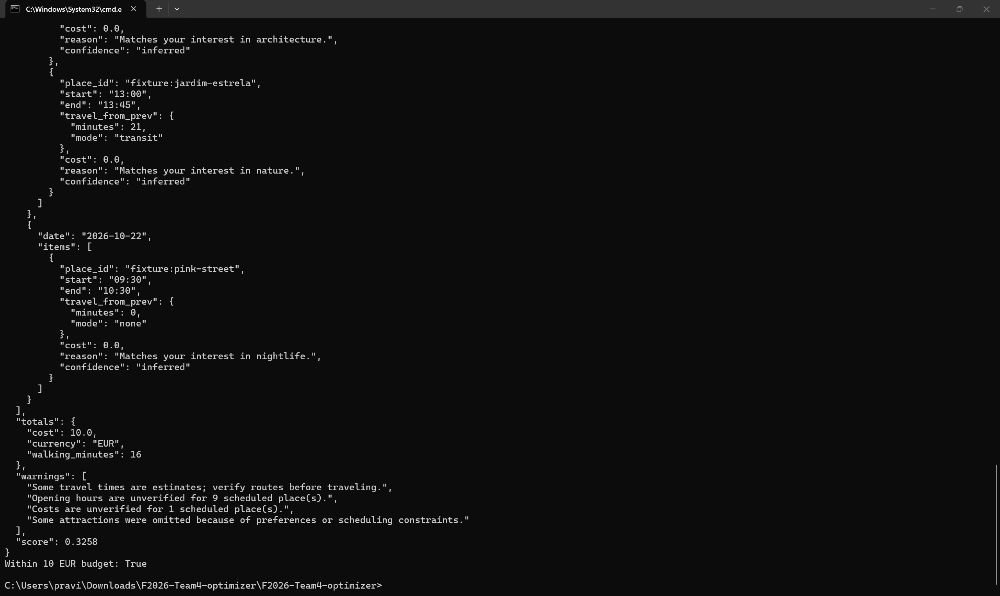
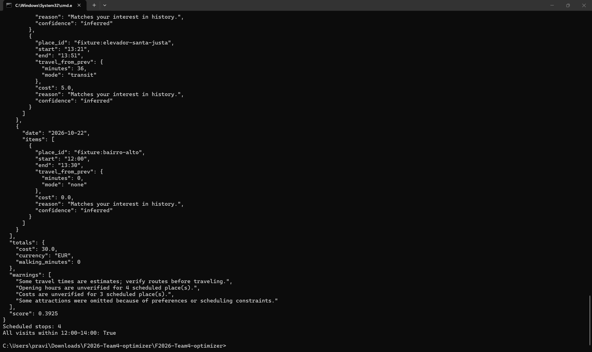
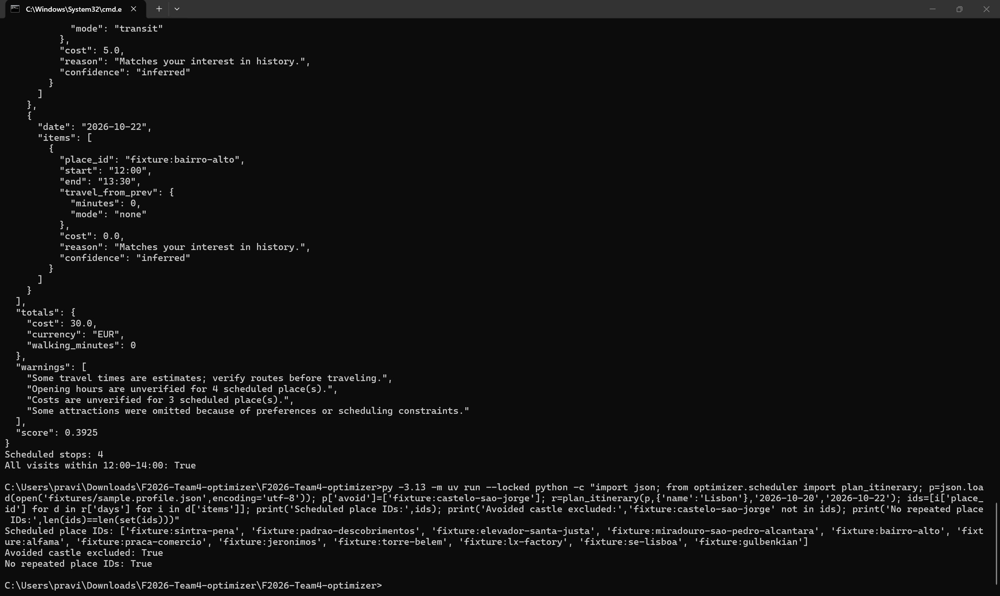
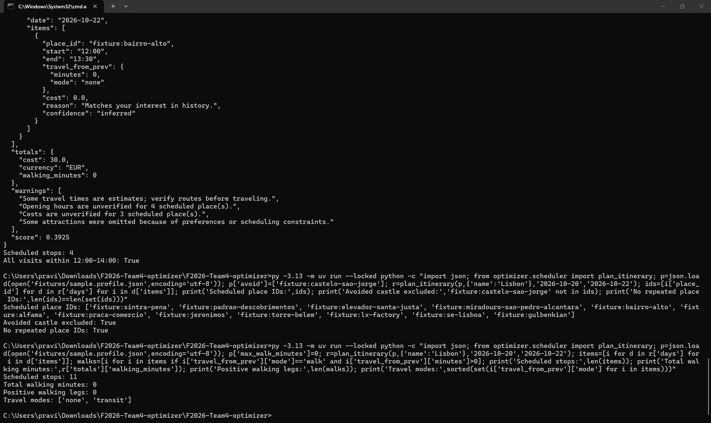
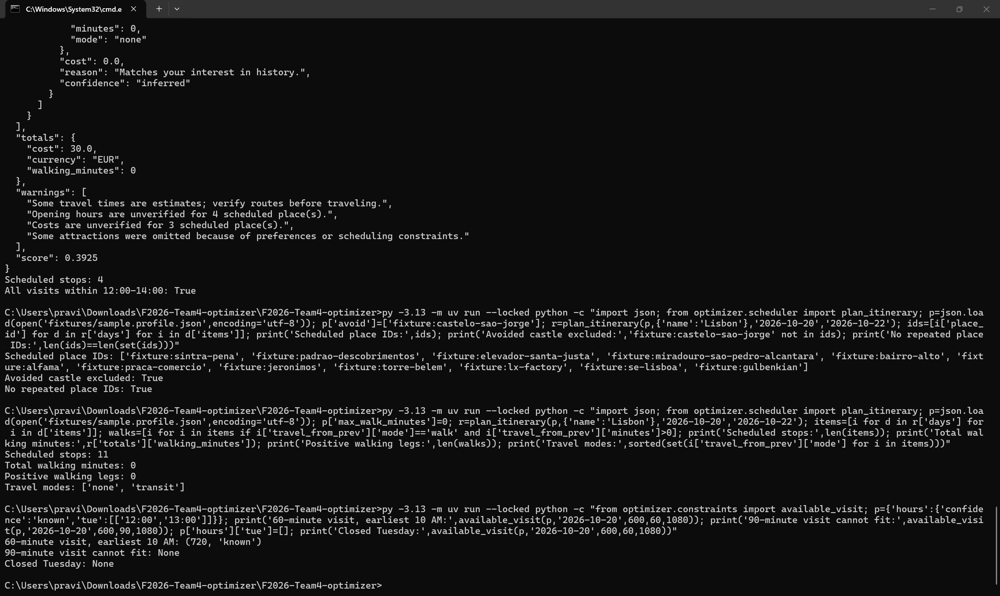
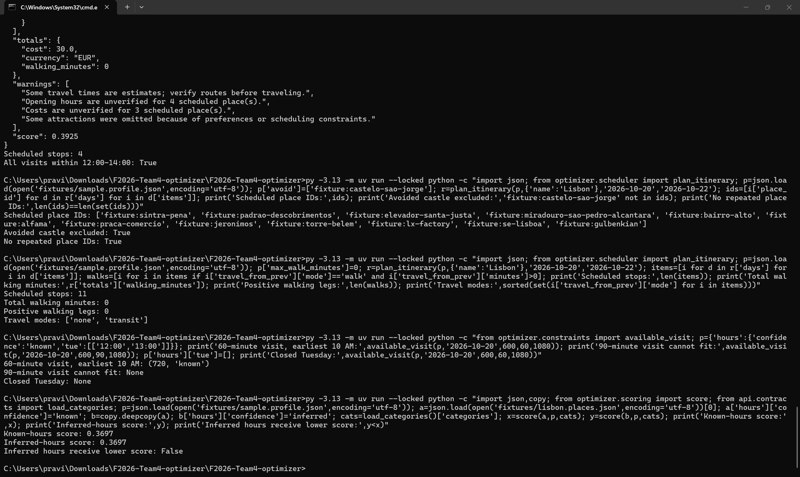

# Sprint 1 optimizer testing

Tested by: Bala Ravi Raja Polisetty
Date: October 18, 2026
Branch tested: optimizer
Tested on: Windows laptop using Command Prompt
Python environment: 3.11.17

I ran the existing tests in the downloaded branch.
I also checked the scheduler directly using the sample
Lisbon places and traveler profile.

These checks were separate from the frontend and API.

## Existing automated tests

### General test run

Command:
`py -3.13 -m uv run --locked pytest -q`

Result: 18 passed, 2 warnings in 1.74 seconds.

The warnings concerned deprecated testing-library usage.
No collected tests failed.

### Scheduler-specific test run

Command:
`py -3.13 -m uv run --locked pytest optimizer/test-scheduler.py -v`

Result: All 8 tests passed in 0.19 seconds.

The tests cover itinerary format, budget, closed places,
opening hours, duplicate attractions, avoided places,
walking limits, and multiple days.

These were existing tests. I did not write them.

## Problem: scheduler tests missed by normal discovery

The general test command collected 18 tests.
The scheduler file contained 8 additional tests that ran
when I named the file directly.

The file is named `test-scheduler.py`, which does not match
the usual pytest filename pattern `test_*.py`.

Suggested fix: rename it to `test_scheduler.py`, then check
that the normal test command collects these tests too.

Passing the general test run alone did not verify these
eight scheduler tests in the version I tested.

## Direct scheduler checks

For each check below, I loaded a fresh copy of
`fixtures/sample.profile.json`.

Trip dates were October 20–22, 2026.
The scheduler adapter loaded the sample Lisbon places.

### Budget of 10 EUR

I changed the total budget to 10 EUR.

Reported total cost: 10 EUR.
The check `total cost <= 10` returned True.

Result: Passed against the stored attraction prices.

The output warned that one scheduled place had an
unverified cost. This does not guarantee actual spending
will stay within 10 EUR or include every travel expense.

### Daily window from 12 PM to 2 PM

I changed Day start to 12:00 and Day end to 14:00.

The scheduler returned 4 stops across the three days.
Every returned visit started at or after 12:00 and ended
at or before 14:00, with start earlier than end.

Result: Passed for visit times in this scenario.

### Avoided place and repeated IDs

I added `fixture:castelo-sao-jorge` to the avoid list.

The returned itinerary excluded that place.
No place ID appeared more than once across the trip.

Result: Passed for both checks.

I did not run a matching baseline to confirm whether
the castle would otherwise have been selected.

### Zero-minute walking allowance

I changed max_walk_minutes to 0.

Scheduled stops: 11
Reported walking minutes: 0
Positive walking legs: 0
Returned travel modes: none and transit

Result: Passed for the returned travel legs.

This does not measure walking inside attractions or
walking to and from transit stops.

## Known opening-hours helper checks

I called `available_visit` directly with a made-up place
marked as having known Tuesday hours from 12:00 to 13:00.

| Check | Expected | Actual |
|---|---|---|
| 60-minute visit, earliest arrival 10 AM | Start at noon | (720, 'known') |
| 90-minute visit | Cannot fit | None |
| Closed Tuesday | No visit | None |

720 means noon in minutes after midnight.

Result: All three helper checks matched expectations.

These checks used controlled inputs, not verified
real-world opening hours.

## Problem: inferred opening hours have no score penalty

The optimizer README lists a Sprint 1 requirement:
inferred opening hours should be treated as soft
constraints with a score penalty.

I compared two copies of the same sample place.
Only hours.confidence changed:
- First copy: known
- Second copy: inferred

All other place details and profile settings were equal.

Known-hours score: 0.3697
Inferred-hours score: 0.3697
Inferred score lower than known score: False

Result: The documented penalty was not applied by
`optimizer.scoring.score`.

The scoring code provided for inspection does not use
opening-hours confidence. The scheduler's selection
utility also does not add a separate confidence penalty.

Suggested fix: apply the agreed penalty for inferred
hours and add a regression test for this requirement.

## Integration point to confirm

The scheduler code calls `optimizer.scoring.score`,
which is a rule-based scorer.

The code inspected does not call Ali's trained ranker
in this scheduling path. Ali and Ram should confirm
how the trained ranking model will connect to scheduling.

This is an integration question, not a failed check
of the trained ranking model itself.

## Scope and limits

The existing tests and direct checks passed except
for the documented inferred-hours penalty check.

The test-discovery issue also needs fixing so normal
test runs include the scheduler tests.

I have not verified:
- The full frontend/API/data/ranker/optimizer flow.
- Scheduling with Sushma's 6,073-place dataset.
- Accuracy of real prices, opening hours, or travel times.
- The routing-spike measurement or algorithm document.
- Every possible input or scheduling condition.

These results apply to the downloaded optimizer branch.
They do not establish that the whole application is
ready or that the scheduler finds the best possible plan.

## AI usage

I used ChatGPT to help writing this report.
I ran the commands and took the screenshots myself.