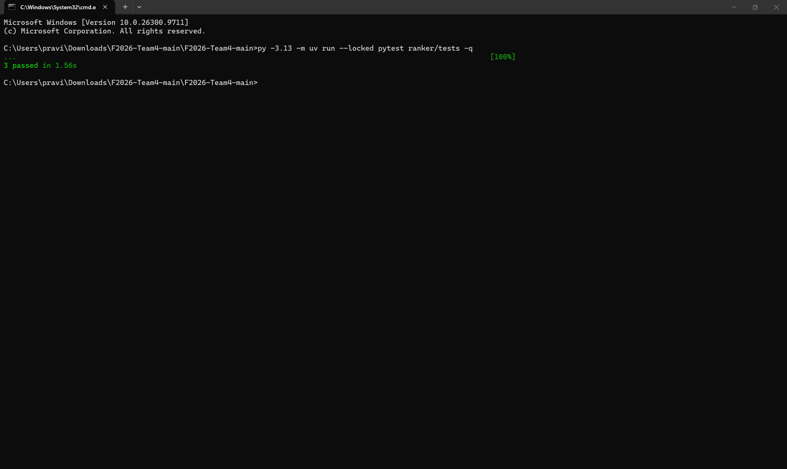
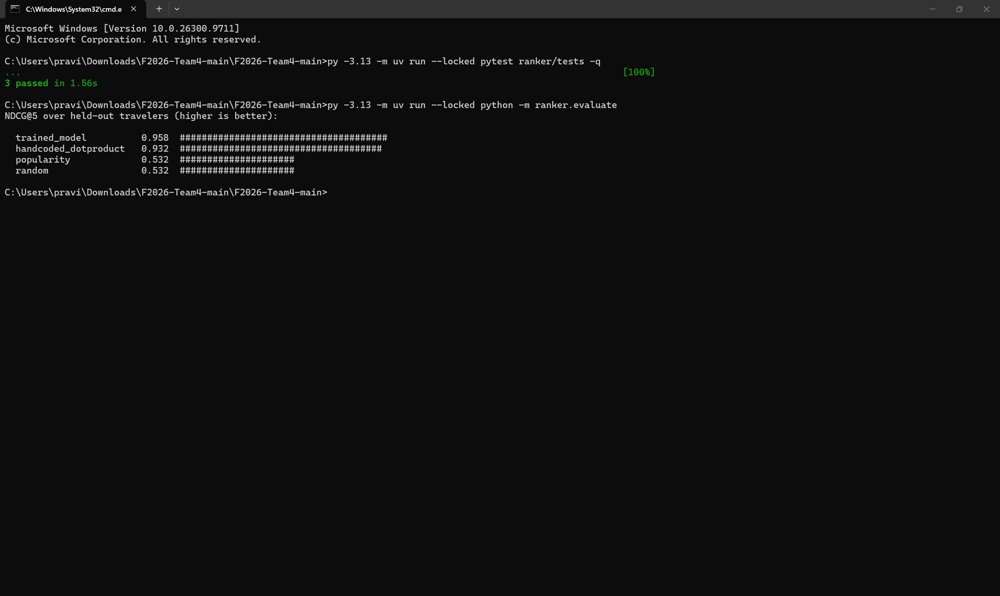
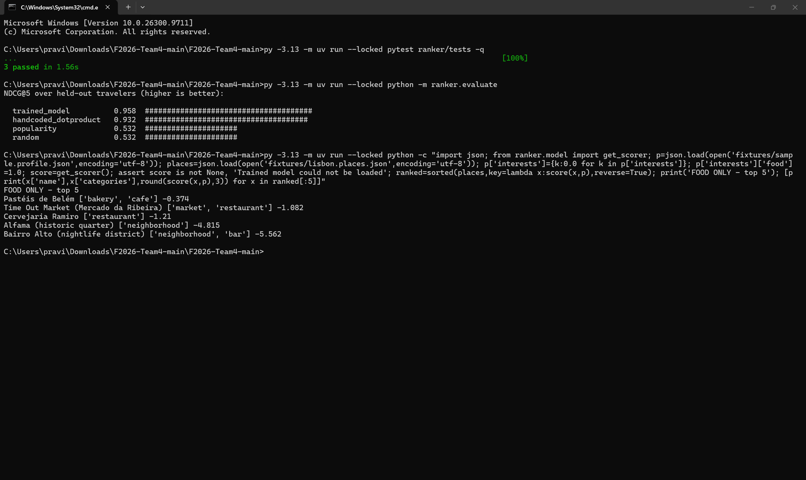
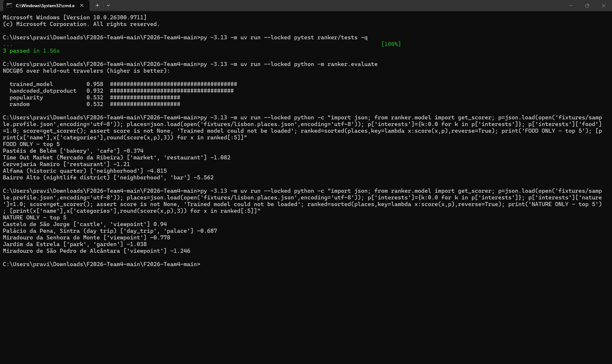

# Sprint 1 ranking model testing

Tested by: Bala Ravi Raja Polisetty
Date: October 18, 2026
Version tested: main ZIP downloaded on October 18, 2026
Tested on: Windows laptop using Command Prompt

I ran the existing ranking tests and evaluation command.
I also checked how the trained model ranked the sample
Lisbon places with food-only and nature-only preferences.

## Existing automated tests

Command:
`py -3.13 -m uv run --locked pytest ranker/tests -q`

Result: All 3 tests passed in 1.56 seconds.

These existing tests check:
- Feature-vector length matches the feature-name list.
- NDCG returns 1 for a perfect example ranking.
- A model trained during the test scores at least as high
  as popularity and random baselines on synthetic test data.

I ran these tests; I did not write them.

## Evaluation against baselines

Command:
`py -3.13 -m uv run --locked python -m ranker.evaluate`

The command completed and returned:

| Ranking method | NDCG@5 |
|---|---:|
| Trained model | 0.958 |
| Handwritten interest-matching rules | 0.932 |
| Popularity | 0.532 |
| Random | 0.532 |

The trained model scored highest in this run.

NDCG@5 measures how well relevant places appear near the
top five results. Higher is better, with 1 being the best
score. This is not an accuracy percentage.

The evaluation uses synthetic travelers and relevance
labels. It does not establish performance for real users.

## Food-only preference check

I loaded the sample traveler profile and Lisbon fixtures.
I set food to 1.0 and all other interests to 0.0.
The other profile settings were unchanged.

The trained scorer loaded successfully.

| Rank | Place | Model score |
|---|---|---:|
| 1 | Pastéis de Belém | -0.374 |
| 2 | Time Out Market (Mercado da Ribeira) | -1.082 |
| 3 | Cervejaria Ramiro | -1.210 |
| 4 | Alfama (historic quarter) | -4.815 |
| 5 | Bairro Alto (nightlife district) | -5.562 |

The top three results had bakery, café, market, or
restaurant categories, matching the food preference.

This command returned the top five places even when
lower-ranked places were not specifically food venues.
It was ranking candidates, not filtering them.

Negative model scores are allowed. They are used for
ordering places and are not ratings or probabilities.

## Nature-only preference check

I used the same sample profile and places.
I set nature to 1.0 and all other interests to 0.0.
The other profile settings were unchanged.

| Rank | Place | Model score |
|---|---|---:|
| 1 | Castelo de São Jorge | 0.940 |
| 2 | Palácio da Pena, Sintra (day trip) | -0.687 |
| 3 | Miradouro da Senhora do Monte | -0.778 |
| 4 | Jardim da Estrela | -1.038 |
| 5 | Miradouro de São Pedro de Alcântara | -1.246 |

The results changed from the food-only ranking.
The returned categories included viewpoints, park/garden,
and a day trip/palace.

This shows that changing the interest affected the
ranking for these sample places. It does not confirm
that every result is ideal for every nature traveler.

## Summary and limits

- All 3 existing ranking tests passed.
- The trained model scored above the three baselines
  in the existing synthetic evaluation.
- Food-only and nature-only preferences produced
  different top-five rankings.
- The trained scorer loaded for both preference checks.

These were separate ranking checks, not full application
integration tests.

I did not retrain the model myself, evaluate it using
real traveler feedback, test it with Sushma's 6,073-place
dataset, or verify the full frontend/backend/optimizer flow.

Ranking a place highly does not confirm that the final
trip follows budget, travel-time, or opening-hours limits.
Those need separate integration checks.

## AI usage

I used ChatGPT to help writing this report.
I ran the commands and took the screenshots myself.