# Sprint 1 saved trips and feedback testing

Tested by: Bala Ravi Raja Polisetty
Date: October 18, 2026
Version tested: main branch downloaded on October 18, after PR #14 was merged
Tested on: Windows laptop using Chrome and Swagger UI

## What I tested

I ran the backend on my laptop and tested creating trips,
getting saved trips, and changing a trip through feedback.

These were manual API tests using http://127.0.0.1:8000/docs.
I checked the response codes and returned trip details.
I did not test these features through the frontend.

## Trip details used

- Destination: Lisbon
- Travel dates: October 20–22, 2026
- Daily times: 10 AM–6 PM
- All seven interests: 0.5
- Pace: 0.5
- Maximum walking minutes: 20
- Budget: EUR 1200
- Dietary preferences: empty

## Results

### 1. Create a trip

I sent the Lisbon request through POST /plan.

It returned 200 with a trip ID and a three-day itinerary.
The plan had 12 stops and a total cost of EUR 84.

Result: Passed for creating a trip response.

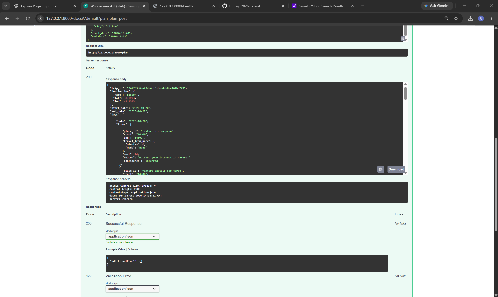

### 2. Get the saved trip

I entered the returned trip ID into GET /trips/{trip_id}.

It returned 200. The trip ID, destination, dates, and visible
first stop matched the original response.

Result: Passed for retrieving the saved trip.
I did not compare every field of this first GET response.

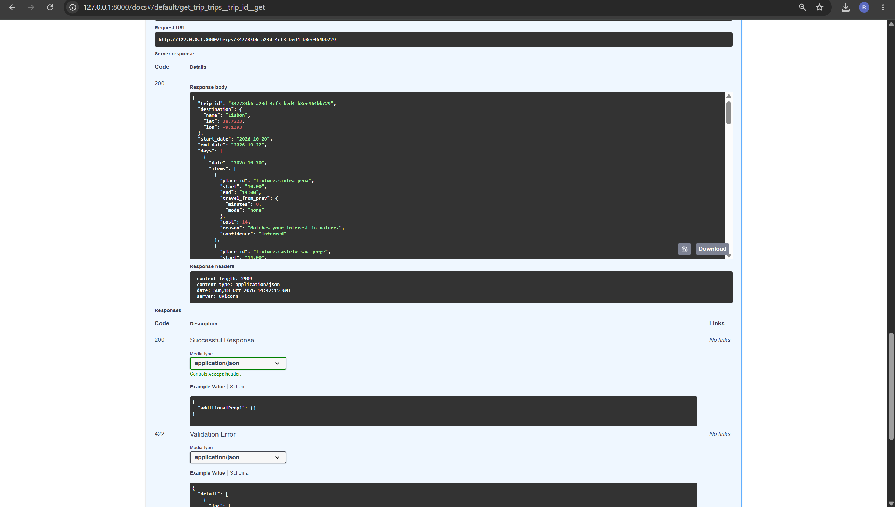

### 3. Reject a place and re-plan

I submitted fixture:sintra-pena in the rejected list.

It returned 200 with the same trip ID.
Sintra Pena was missing from the whole returned plan.
The schedule changed, and the total became EUR 70.
The listed stop costs matched that total.

Result: Passed.

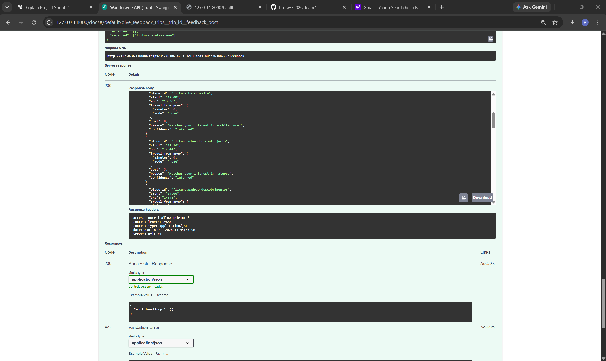

### 4. Get the updated trip

I used GET again with the same trip ID.

It returned 200 with the updated EUR 70 plan.
Sintra Pena was still absent.
The full response matched the feedback response.

Result: Passed during the same running backend session.

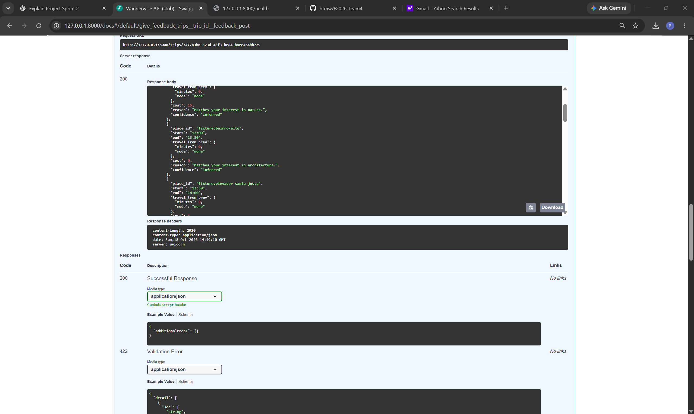

### 5. Get a trip that does not exist

I entered nonexistent-trip into GET /trips/{trip_id}.

It returned 404 with:
"No trip with id 'nonexistent-trip'."

Result: Passed. This was an expected error response.

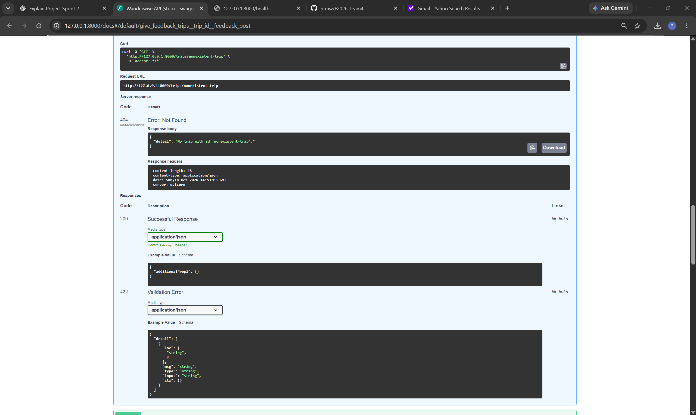

### 6. Submit feedback for a trip that does not exist

I submitted feedback using nonexistent-trip as the trip ID.

It returned 404 with:
"No trip with id 'nonexistent-trip'."

Result: Passed. This was an expected error response.

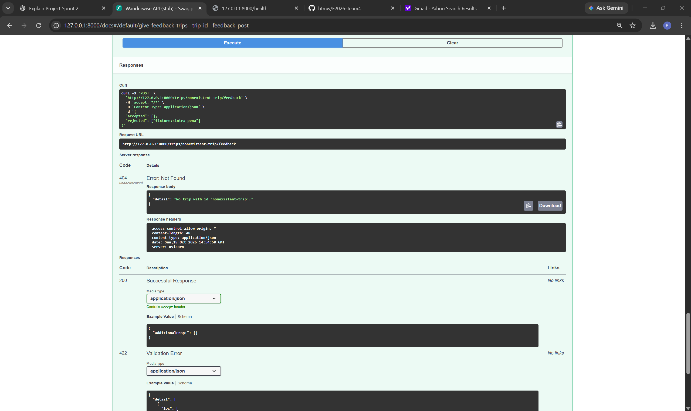

### 7. Submit feedback in the wrong format

I sent rejected as the number 123 instead of a list.

It returned 422 with:
"Input should be a valid list."

Result: Passed. The incorrect input was blocked.

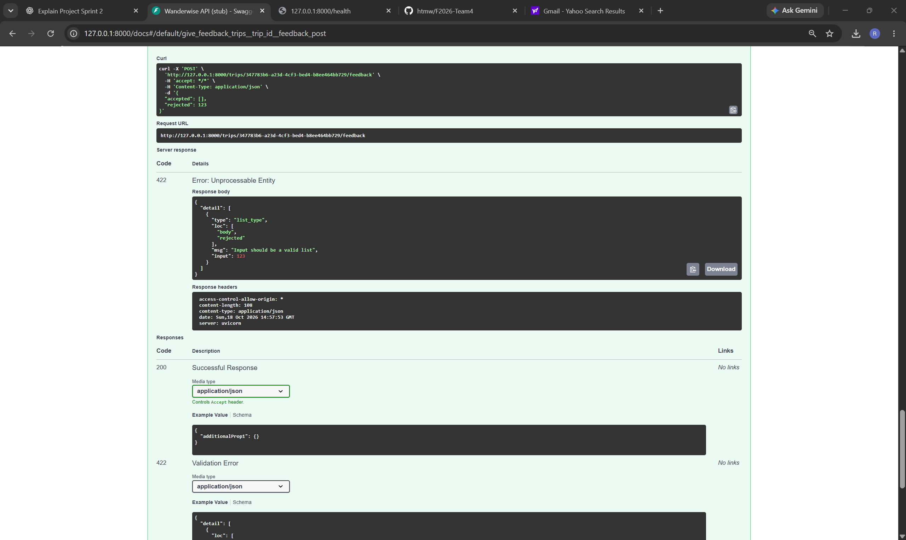

### 8. Check whether earlier rejections are remembered

On the original trip, I next rejected fixture:castelo-sao-jorge.

It returned 200.
Both Castelo Sao Jorge and the previously rejected Sintra Pena
were absent from the whole plan.
The total became EUR 65, matching the listed stop costs.

Result: Passed.

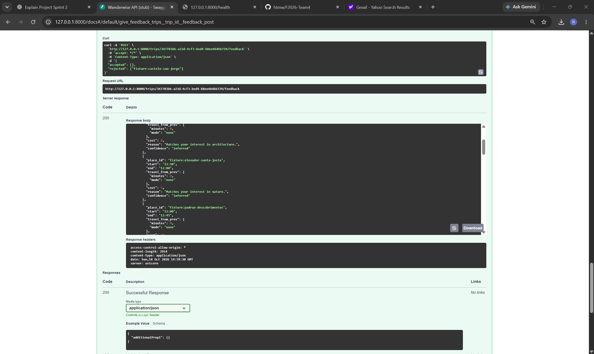

### 9. Submit accepted feedback

I submitted fixture:bairro-alto in the accepted list,
with an empty rejected list.

It returned 200.
The itinerary stayed the same at EUR 65.
Both previously rejected places remained absent.

Result: Passed for accepting the request and preserving
the earlier exclusions.

This response does not prove that the accepted preference
was stored internally. The API description says accepted
places are recorded but are not used by the stub scheduler yet.

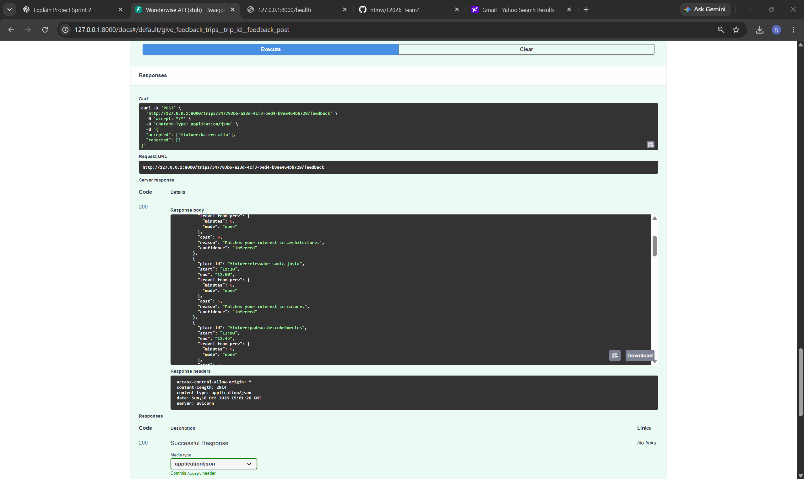

### 10. Create a separate trip

I sent the original Lisbon request through POST /plan again.

It returned a different trip ID.
Sintra Pena and Castelo Sao Jorge were included again,
and the total was EUR 84.

Result: Passed. The first trip's feedback did not carry
over into this new trip.

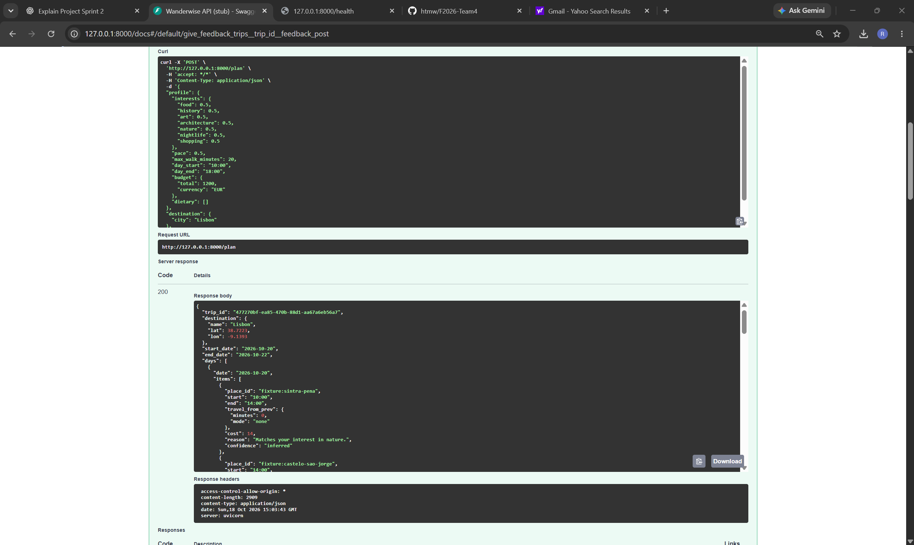

### 11. Check the old trip after creating the new one

I retrieved the original trip again.

It still returned the EUR 65 plan.
Both rejected places remained absent, and its schedule
matched the previous version.

Result: Passed. Creating another trip did not overwrite
the original trip.

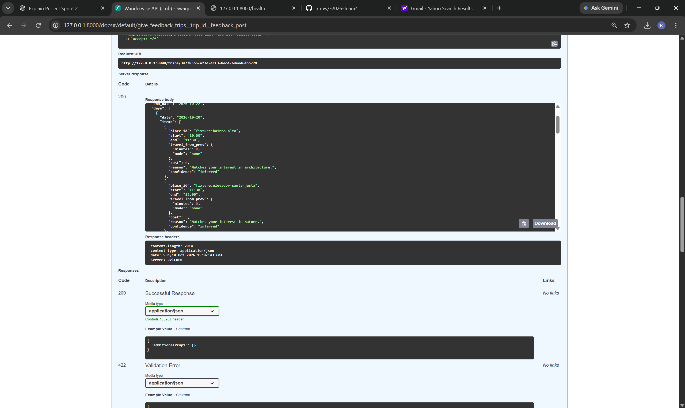

## Limits of this testing

The returned warning says this version still uses the stub
scheduler and Lisbon sample places. Travel time, opening
hours, and budget are not enforced yet.

These results check the saved-trip and feedback API flows.
They do not confirm that the final optimizer, learning-to-rank
model, or live data are connected or working correctly.

All saved-trip checks were done while the same backend
process was running. I have not checked whether trips remain
available after restarting it.

I did not run an automated test suite in this testing round.

## Setup note

With --reload enabled, the backend repeatedly restarted
after detecting changes inside installed packages in .venv.

I stopped it and ran it without --reload.
The health endpoint then returned {"status":"ok"},
and I continued testing.

## AI usage

I used ChatGPT to help writing this report.
I ran the tests and took the screenshots myself.